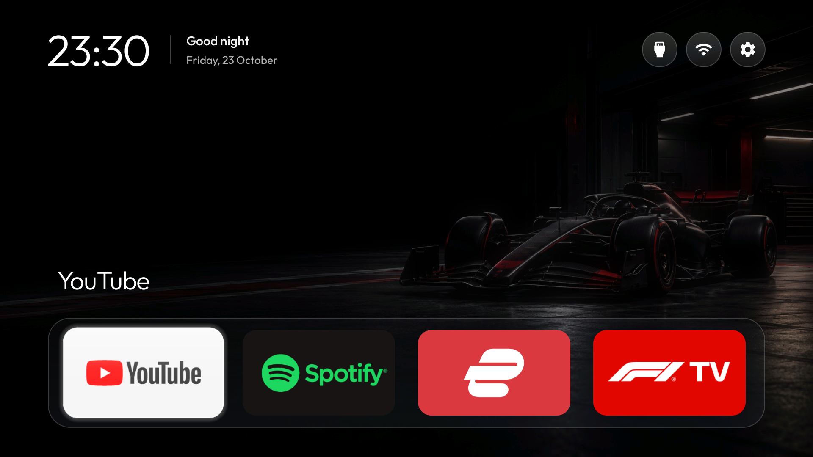
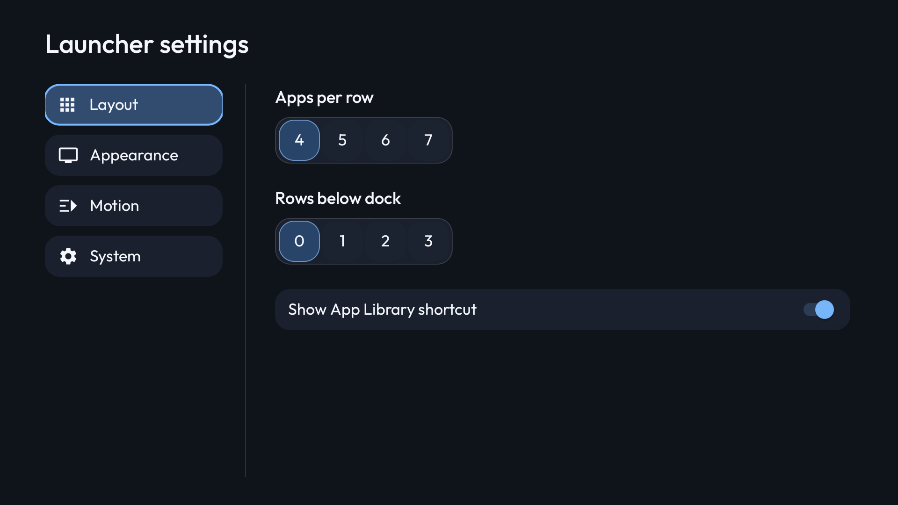
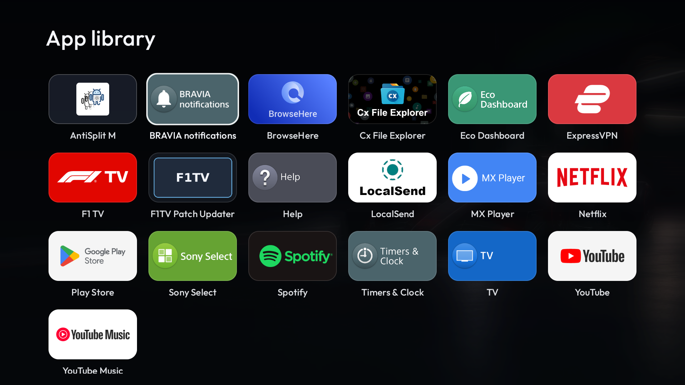

# Real-TV screenshots

Sony KD-55X9000H, Android 12, PA firmware STT2.230505.001.S137 / 626241. These are actual screenshots taken during the v2.6.0 redesign validation, not mockups. The build-16 follow-up changes input routing, not these layouts. No account, Wi-Fi name, address or device identifier is shown. App logos belong to their respective owners and are displayed from installed apps; they are not a bundled icon pack.

## Home

Four-app dock, compact floating header and icon controls. The dark motorsport wallpaper shown was created for this personal setup; it is not required to build the launcher and is not included as a distributable theme.

## Launcher settings

Category sidebar, numeric choices and native switches, with focus gutters.

## App Library

Alphabetical banner grid with a restrained focus outline and original installed-app artwork.

[Build and behavior](../premium-redesign.md) · [Changelog](../../CHANGELOG.md).
